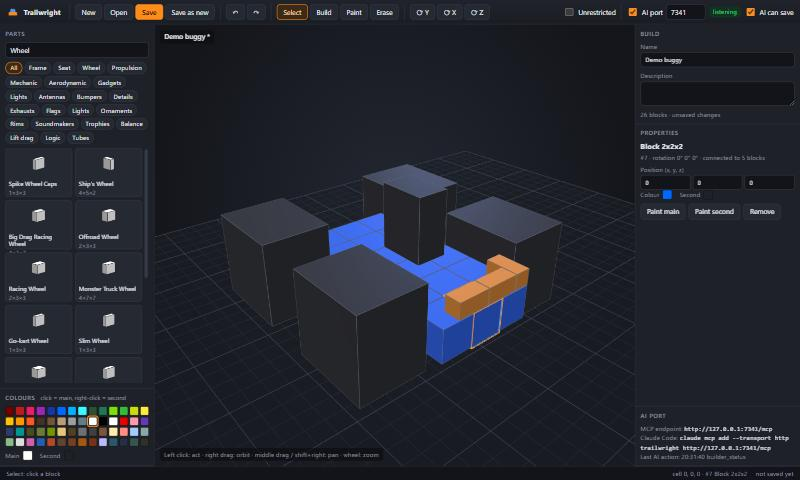

# Trailwright

A blueprint manager and 3D builder for **Trailmakers**, with a built-in AI port so an AI model can build vehicles for you.

Trailwright is a separate Windows app, not a game mod. It reads and writes the same blueprint files the game uses (`Documents\TrailMakers\Blueprints`), so anything you save shows up in the game's blueprint menu.



> **Status (v0.1.0, pre-release):** the file format is fully worked out and verified: 228 real blueprints, autosaves and transformation slots round-trip byte for byte, and files written by Trailwright decode with independent tools. Blocks placed by Trailwright get exactly the connections the game itself would make (375 of 375 re-placed blocks matched). **What has not happened yet is loading a Trailwright-edited blueprint in the game itself.** Keep the automatic backups until you have tried it.

**Known limitations**

- Blocks are drawn as boxes the size of their grid cells, not with the game's models.
- Logic links (seat or sensor to block) store two offsets. Trailwright keeps the first (the linked block) correct when blocks are removed. The second (`m_socketOffset`) is not a block index and its meaning is not known yet, so it is kept as it was. Adding blocks is unaffected; removing blocks from a build with logic links is the case to check in game.
- New blocks get the game's own default settings for their type. Key bindings start empty: set them in the properties panel or with `set_block_keys`.

## What it does

- **Library**: browse every blueprint, autosave and transformation slot with its picture, name and block count.
- **Builder**: a 3D view of the vehicle. Select, build, paint and erase blocks; move them with the arrow keys and Page Up/Down; turn them with R / T / F; undo and redo. Every block in the game's catalog (502 types) is in the parts palette with its real size.
- **Block settings**: the sliders from the game's block menu (speed, strength, damping, angle, power...) with the game's own ranges, plus key bindings.
- **Unrestricted** (off by default): lets settings go past the game's limits. See the note below.
- **AI port**: a local [MCP](https://modelcontextprotocol.io) server that lets an AI model work inside the builder.
- **Safe saving**: "Save" overwrites the file you opened, but copies the old one to `%LOCALAPPDATA%\Trailwright\backups` first. "Save as new" writes a new `Blueprint_<timestamp>.png`. Nothing is ever deleted.

### About Unrestricted settings

Trailwright writes whatever value you set. The game, however, clamps most block settings to their normal range when it loads a blueprint: the jet, propeller and spinner code was read line by line, and every other slider block type shows the same pattern in the game's code (`Internal_ApplyBlockBehaviourSetup`). So values past the limit are stored in the file but most likely behave like the maximum in game. The app says this before you switch it on, and marks settings that are past the game range.

## The AI port

Tick **AI port** in the top bar (default port 7341). The model can then:

| Tool | What it does |
|---|---|
| `builder_status` | name, block count, bounds, unsaved changes, most used parts |
| `list_block_types`, `block_type_info` | search the catalog; size, attachment points and setting ranges of a part |
| `get_blocks`, `get_block`, `layer_map` | what is placed where; a text map of one layer seen from above |
| `check_placement`, `find_attach_spots`, `fit_block` | dry runs: which cells are taken, where a part can attach, which rotations fit |
| `place_block`, `place_blocks`, `move_block`, `remove_blocks` | build (placement is refused, with the reason, if cells are taken or the part would not attach) |
| `paint_blocks`, `get_palette`, `set_block_setting`, `set_block_keys`, `list_key_actions` | colours, slider settings (capped unless the user ticked Unrestricted) and key bindings |
| `set_build_info`, `undo`, `redo`, `new_build`, `save_build` | name/description, history, saving |

The AI only reaches the builder: it cannot open, browse or delete your blueprints, and it cannot change app options such as Unrestricted. Untick **AI can save** if you want to do all saving yourself. Changes the AI makes appear in the 3D view as they happen.

**Claude Code:**

```bash
claude mcp add --transport http --scope user trailwright http://127.0.0.1:7341/mcp
```

Any other MCP client that speaks streamable HTTP works the same way. The port listens on 127.0.0.1 only.

## Install

Download `Trailwright.exe` from the [releases](https://github.com/Nitro70/Trailwright/releases) and run it. It is a single self-contained file (no .NET install needed). It needs the Microsoft Edge WebView2 Runtime, which Windows 10 and 11 already have. The exe is not code-signed, so SmartScreen may warn the first time.

## How Trailmakers blueprints work

A blueprint is an ordinary PNG picture of the vehicle. The data hides in the **fully transparent pixels**:

- Pixels are read in Unity order (bottom row first). Each transparent pixel carries 3 bytes in R, G, B; opaque pixels (the picture) are skipped. The top-right pixel holds the header length.
- The stream is a header (`8` + protobuf `SaveGameInPNGInfo`; files from before October 2026 use a .NET BinaryFormatter header instead), padded to a whole pixel, then:
  - the **structure**: an LZ4 frame holding protobuf `StructureGraphSaveDataProto` (every block node with grid position, quarter-turn rotation, block GUID, colours, slider values and key bindings, plus the connection list and weld groups),
  - the **identifier**: protobuf with the blueprint's GUID,
  - the **meta**: name, description and creator, protobuf compressed with Smaz.
- Positions are grid cells of 0.25 m; rotations are quarter turns about X, Y, Z applied in Unity's Z, X, Y order.
- Two blocks are connected when both have an attachment point on the touching faces.
- When the blocks change, Trailwright drops the saved weld groups so the game computes them itself (it does this whenever they are missing).

**When the game sees changes:** it reads all blueprints when a session starts and refreshes the list when you open its blueprint menu, so a saved file appears the next time you open that menu. Autosaves are written when you leave the builder.

The `tools/` folder has the scripts used to work this out (an IL2CPP metadata v39 reader, a block catalog generator and a format prototype). They read the installed game only; set `TRAILMAKERS_DIR` if the game is not in the default Steam folder.

## Build from source

```bash
dotnet test tests/Trailwright.Tests
dotnet publish src/Trailwright.App -c Release -r win-x64 -o bin/publish
```

`Trailwright.exe --headless --ai on` runs the servers without a window (for testing; nothing is saved to settings).

## Licence

MIT. Third-party parts are listed in [THIRD-PARTY-NOTICES.md](THIRD-PARTY-NOTICES.md). Trailwright is an unofficial fan tool, not affiliated with Flashbulb Games.
